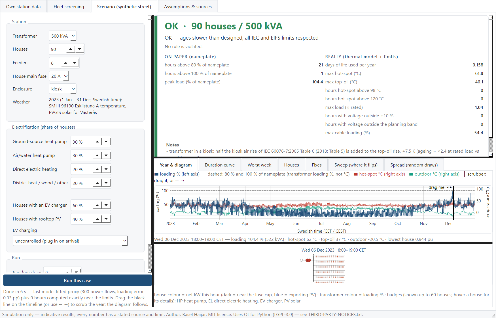
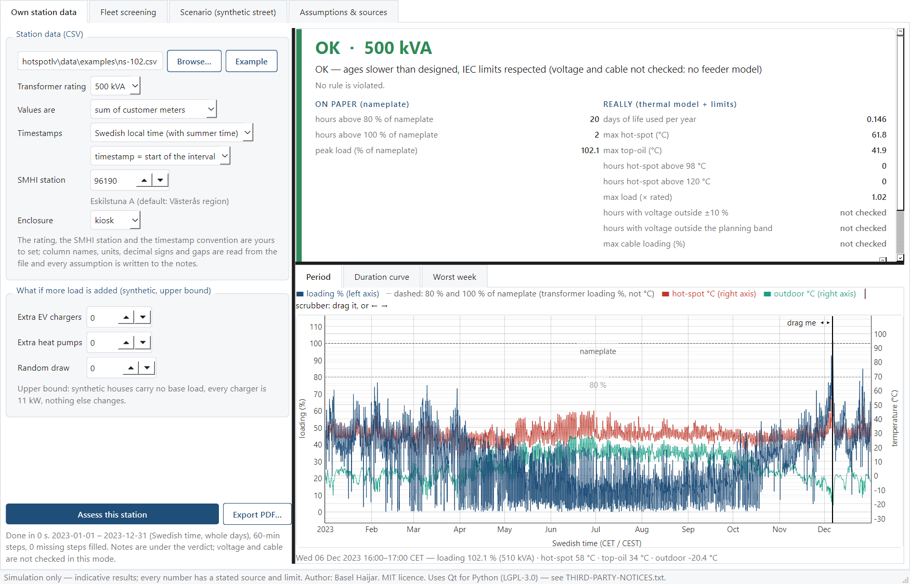
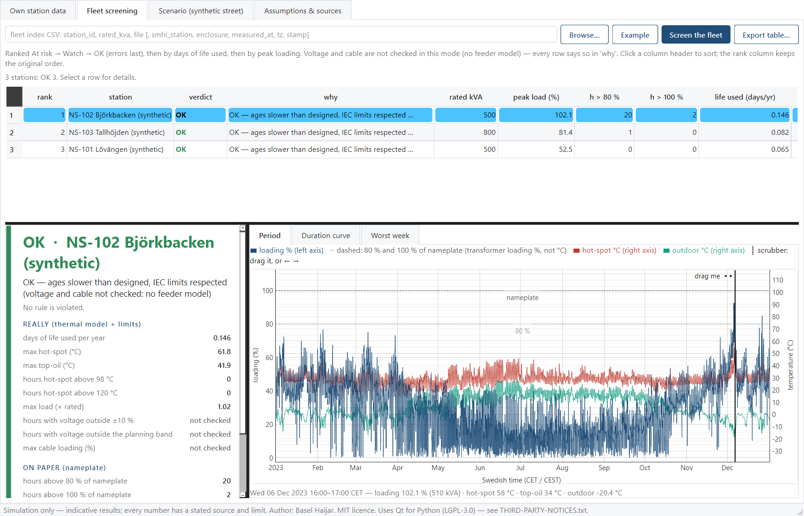
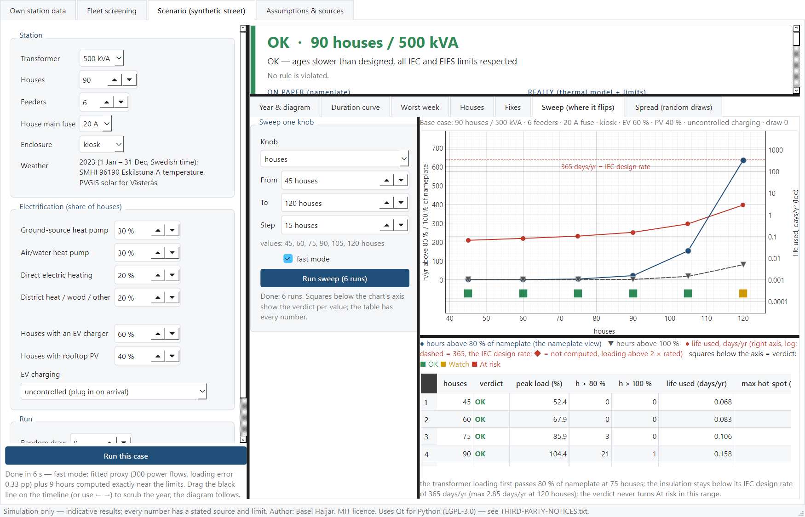
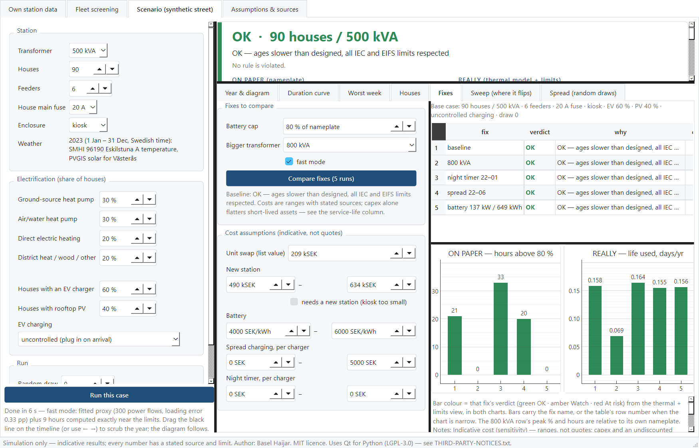
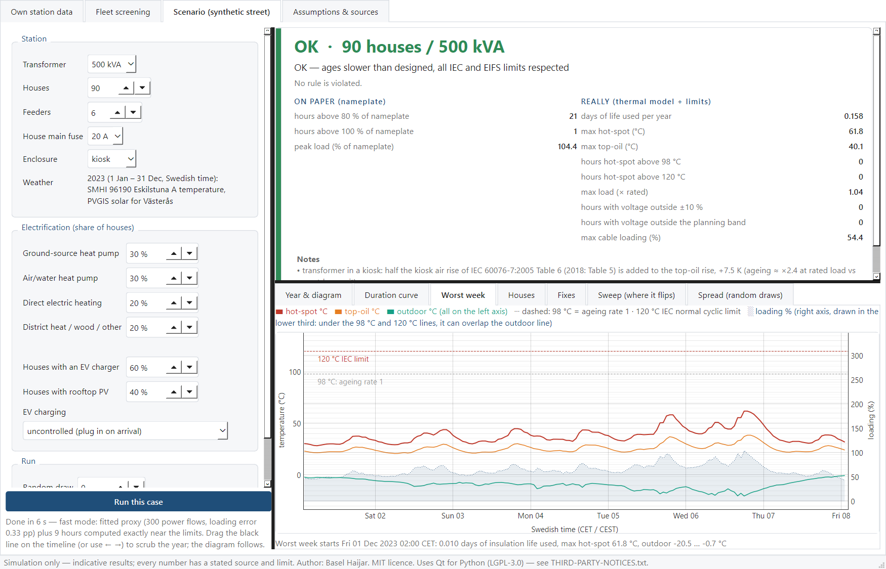
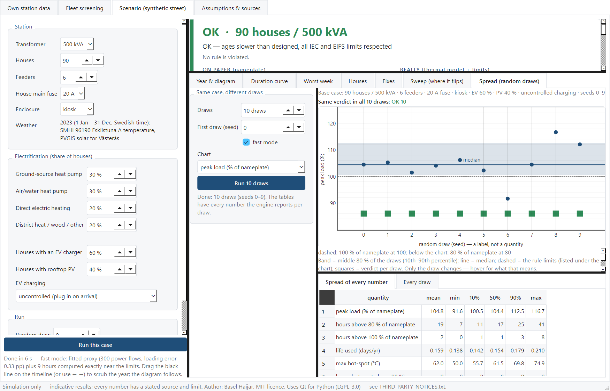

# Hotspot LV

**Hotspot LV** is an open Windows desktop application for screening Swedish secondary-substation (nätstation)
transformers under electrification. It answers one question per station: *is this transformer only overloaded on
paper, or does the IEC 60076-7 thermal model say it reaches its limits?*

It reads a grid company's (DSO's) own meter data or a whole fleet of stations, or it builds a synthetic street. It then runs a
full year hour by hour with measured SMHI air temperature (and PVGIS solar). It judges the result with the
IEC 60076-7 thermal model of the transformer, the Swedish voltage rule (EIFS 2023:3) and the cable ratings.

The nameplate view ("hours above 80 % of nameplate", counted on the transformer's modelled loading) is always shown
next to the thermal view, so the two can be compared.

> **Simulation, not measurement.** The transformer uses the generic constants of IEC 60076-7. The verdicts are
> indicative screening results, not a rating of any real unit. Every assumption and limit is listed in the program
> under *Assumptions & sources*.

**Author:** Basel Haijar · Electrical & Electronics Engineer · [LinkedIn](https://www.linkedin.com/in/basel-haijar)

**The study:** [STUDY.md](STUDY.md) is a thermal ageing & dynamic loading study made with this tool. It covers three
street types and 13 weather years of measured SMHI temperature. [Summary below](#the-study-in-short).

## About, in plain words

A nätstation is the small kiosk in the street with a transformer inside. One documented way to screen it is a rule of
thumb (Energiforsk 2018:552). If the houses' summed meter readings pass 80 % of the transformer's rating, the station
is "overloaded on paper".

But a transformer does not fail at 100 %. What wears it out is heat. The hottest point in the winding, the
*hot-spot*, slowly cooks the paper insulation. The loading guide IEC 60076-7 gives the chain:

    load + outdoor temperature → oil temperature → hot-spot → days of insulation life used

- **Ageing:** at 98 °C the paper ages at its design rate, and every 6 °C hotter doubles the ageing.
- **Short-peak limits:** the guide also limits the current and the temperatures during short peaks.

**The question.** On a Swedish street adding heat pumps, EV chargers and rooftop solar, how far apart are
"overloaded on paper" and "really at the limit"?

**The answer, in this simulation:**
- **The gap:** the transformer reaches its IEC normal cyclic limit at about 1.6–1.85 times the houses at which the
  80 % rule first flags the station.
- **Most of that gap is the standard itself:** it allows 1.5 × rated current in normal cyclic loading.
- **What bites first** is a short peak on a cold winter evening, not slow ageing.
- **The weather year:** the coldest year in the data (2010) brings the limit at 18–19 % fewer houses than the median
  of 13 years.
- **Not advice to load real transformers harder.** The rule's margin also covers phase imbalance and peaks inside
  the hour, which this study does not model.

## Engineering highlights

- **IEC 60076-7 thermal model**:
  - top-oil and winding hot-spot by the standard's difference equations;
  - insulation ageing (kraft or thermally upgraded paper);
  - the IEC kiosk correction (2005 edition, Table 6), applied to a prefabricated nätstation;
  - Ecodesign Tier-2 losses per transformer size.
  - Checked, code against code, against the IEC 60076-7:2005 Annex C worked example (a permanent unit test) and
    against Alliander's open thermal library on the same inputs (within 0.1 K on three cases). These checks are of
    the implementation, not of the model against a real transformer.
- **One verdict with its reason:** OK / Watch / At risk.
  - The rules: the IEC normal-cyclic and long-time-emergency limits (current, hot-spot, top-oil, ageing), EIFS
    2023:3 (every house within ±10 %) and the cable ratings.
  - Two Watch margins are chosen for this tool, not taken from a standard: ageing above half the design rate, and a
    house voltage outside 0.92–1.05 pu.
  - Each verdict names the rule and source that triggered it, and says which rules could not be checked.
- **Full-year hourly power flow** (pandapower) of the low-voltage network: transformer, main cables, service cables,
  and houses behind their main fuses.
  - A fast mode fits a proxy (a quick fitted stand-in) on a sample of exact power flows, and re-runs exactly every
    hour near a limit.
  - When the proxy does not fit well enough, the whole year runs exactly.
- **Real weather:** SMHI hourly air temperature for the station's own years, from the SMHI station you choose,
  downloaded once and cached, with the gap rules stated in the result. Charts show Swedish local time
  (CET/CEST).
- **A grid company's own data:** reads a meter export the way a Swedish DSO delivers it.
  - **The file:** UTF-8, UTF-16 or Windows-1252; `;`, tab or `,`; lines above the header and a sum line below the
    table.
  - **The values:** Swedish or English headers; kW, kWh or Wh per interval, hourly or 15-minute; decimal commas,
    thousands dots and gaps.
  - **The time:** day-first or month-first dates; Swedish local time or normaltid, detected from the
    daylight-saving days.
  - **Several stations:** a file with a `Nätstation` column is screened as a fleet.
  - It says what it found in the file and what the file could not tell.
  - It is tested on eleven constructed files of those shapes (`tests/fixtures/dso_exports`), not yet on a real DSO
    export.
- **Transformer sizes:** 50 to 1 000 kVA with their Ecodesign Tier-2 losses, or a custom unit with the losses from
  its test report.
- **Station card and report:**
  - an A4 card of one station's verdict, charts, inputs, method and rules, for a planning file;
  - the same as a report from one command (`hotspot-lv report`), as PDF or HTML.
- **Planning views for a synthetic street:**
  - *Fixes*: a bigger transformer, two smart-charging schemes (a night timer, spread charging) or a battery, on
    the same houses, with indicative costs.
  - *Sweep*: where the verdict flips as houses, EVs or PV are added.
  - *Spread*: the same street with different random draws of the houses.
- **Tested:** 362 automated tests (pytest). The Windows build checks itself with a `--self-test` that runs every mode
  without a window.

**Tech:** Python · PySide6 (Qt) · pyqtgraph · pandapower · pandas / NumPy · pvlib · matplotlib · pytest ·
PyInstaller

## Screenshots

All screenshots show synthetic data: the study's villa-suburb street and the program's example stations, not
measurements.

**Scenario: the study's villa suburb.**
- **The case:** 90 houses on a 500 kVA kiosk transformer with six cables, the study's 2030 mix, and the weather of
  2023.
- **On paper:** the transformer's own loading peaks at 104 % of nameplate. The summed meters, which the study's
  80 % rule looks at, peak at 95 %.
- **The thermal model:** a 62 °C hot-spot and 0.16 days of insulation life used per year, so the verdict is OK. The
  study's own result file has the same numbers for this case.
- **The view:** the year runs in Swedish time, and the street diagram follows the scrubber (the line you drag along
  the year).



**Own station data:** one station's summed meter values, here a synthetic example, at 500 kVA. Voltage and cable
rules show as "not checked", because meter sums carry no network model.



**Fleet screening:** stations ranked At risk first, then by insulation life used and peak load, with the rule behind
each verdict.



**Sweep (where it flips):**
- **What it runs:** the same street from 45 to 120 houses.
- **The two views:** the nameplate view (hours above 80 % and 100 %) next to the modelled ageing, on a log axis,
  with the IEC design rate.
- **The result:** at 120 houses the verdict turns Watch, on the voltage planning margin (0.92–1.05 pu), because
  the six cables now carry 20 houses each. The study adds cables instead. The transformer stays just inside its
  limits there: a 118 °C hot-spot and 2.85 days of life used per year.



**Fixes:** a bigger transformer, two smart-charging schemes and a battery, on the same houses, with indicative costs.
Here the 800 kVA swap cuts the ageing from 0.16 to 0.07 days per year. The night timer *raises* the hours above
80 %, because it starts every car between 22:00 and 01:00, on top of the night heating.



**Worst week:** the seven days with the most insulation ageing. Hot-spot, top-oil and outdoor temperature are shown
against the 98 °C and 120 °C lines, with the loading in the lower third.



**Spread (random draws):** the same street with ten different random draws of houses, cars and panels. The peak
ranges over 92–117 % of nameplate, so a single draw is only one possible street.



**Station card:** *Export PDF…* on the *Own station data* tab writes an A4 card with the verdict, the three charts,
the inputs, the method and every rule with its source.

## Download for Windows

The download is version 0.1.0. Version 0.2.0 is this source code (see [CHANGELOG.md](CHANGELOG.md)). It is not
built or released yet, so its new features need the Python install ([Run from source](#run-from-source)).

1. Download `HotspotLV-0.1.0-win64.zip` and `HotspotLV-0.1.0-win64.zip.sha256` from the
   [latest release](https://github.com/basel19982323-ux/hotspot-lv/releases/latest).
2. Check the download. In PowerShell, in the download folder, this must print `True`:
   ```powershell
   (Get-FileHash .\HotspotLV-0.1.0-win64.zip -Algorithm SHA256).Hash -eq (Get-Content .\HotspotLV-0.1.0-win64.zip.sha256).Split(' ')[0]
   ```
3. Extract the zip into a short path, for example `C:\Tools`, which creates `C:\Tools\HotspotLV`. Double-click
   `HotspotLV.exe` there. Keep the folder together: the program needs the `_internal` folder next to it.

**Good to know**
- **Not code-signed.** On the first start, Windows SmartScreen may say *Unknown publisher*. Choose *More info* →
  *Run anyway* if the checksum matched. Managed PCs may block unsigned programs; ask your IT department.
- **Works offline** with what it ships: the Eskilstuna A / Västerås weather of 2023 and three synthetic example
  stations.
- **Station data outside 2023**, or another SMHI station, needs that station's hourly temperatures. These are
  downloaded once from SMHI's open-data service and cached in `%USERPROFILE%\.hotspotlv`. Nothing else is sent or
  fetched. SMHI publishes its checked archive about three months late, so the newest hours come from SMHI's
  latest-months data; the result says from when.
- **Check an installation** without opening a window. In PowerShell, in the `HotspotLV` folder, this takes about
  two minutes and must print `0`. Then `C:\Temp\hotspot-check\self-test.txt` ends with ALL PASSED:
  ```powershell
  $p = Start-Process .\HotspotLV.exe -ArgumentList '--self-test', 'C:\Temp\hotspot-check' -Wait -PassThru; $p.ExitCode
  ```
- **To remove it**, delete the `HotspotLV` folder and `%USERPROFILE%\.hotspotlv`. Qt remembers the last folder of
  its file dialogs under `HKEY_CURRENT_USER\Software\QtProject`, shared with other Qt programs. Delete that entry
  only if no other Qt program uses it.

## Using it

The window has four tabs.

| Tab | What you give it | What you get |
|---|---|---|
| **Own station data** | One station's export (the sum of its customers' meters, or a station meter), its kVA (50–1 000 kVA, or a custom unit with its own losses), enclosure and nearest SMHI station | The verdict for the data's own years, with ON PAPER (nameplate) and REALLY (thermal model + limits) side by side; the period timeline, duration curve and worst week; a *File* tab with what was read from the file; a station card as PDF |
| **Fleet screening** | An index CSV with one row per station (its id, kVA and the file of its meter values), or one export with every station in a `Station` / `Nätstation` column | A ranked table: At risk first, with the rule that decided each verdict; CSV export |
| **Scenario (synthetic street)** | A synthetic street: houses, heating mix, EV and PV shares, transformer size, number of feeders (cables) | The verdict for a full year; *Fixes*, *Sweep* and *Spread* to explore it |
| **Assumptions & sources** | — | Every constant, rule and data source, with its licence |

Start with the bundled examples, which are synthetic, not measurements:
- *Own station data* → *Example* → *Assess this station*;
- *Fleet screening* → *Example* → *Screen the fleet*;
- *Scenario (synthetic street)* → *Run this case*. A full year takes from a few seconds to about two minutes.

**What ON PAPER counts.** The app's "hours above 80 % of nameplate" counts the transformer's own loading, with an
assumed power factor, the losses and the voltage under load. The documented 80 % screening rule (one DSO's,
Energiforsk 2018:552) uses the summed meter values, which read 7–16 % lower at the peak. STUDY.md uses that rule.

**What it cannot see.** In *Own station data* the meters give the transformer's load but not the street's
voltages or cable currents, so those rules show as "not checked". Phase imbalance and peaks inside the hour are not
modelled in any mode. These limits are stated on every result.

**What the file cannot tell.** Some things no export shows:
- **The interval convention:** whether a stamp starts or ends its interval. You set it.
- **The clock,** when the file has no daylight-saving day.
- **The unit** of a bare `Värde` column.
- **The day and month order,** when no date has a day above 12 and both orders give a regular series (one day
  of data, for example).

The *File* tab and the report list what was assumed for each of these. A quarter-hour column without a unit is
refused until you choose the unit, because kW and kWh per 15 minutes differ by four times.

## A report from one command

With the Python install ([Run from source](#run-from-source)), one command writes one station's report without
opening a window:

```powershell
hotspot-lv report station.csv --kva 500 --out station-report.pdf
```

`python -m hotspotlv report …` is the same command.

- **The file:** `--out` ends in `.pdf` (A4, like the station card) or `.html` (one file, with the charts inside).
- **What the report has:**
  - what was read from the file;
  - peak load against the rating;
  - the hot-spot and top-oil temperature duration curve;
  - the hours above the IEC 60076-7 normal cyclic limits;
  - the relative ageing rate;
  - the verdict.
- **The note it carries:** *Indicative result, generic transformer constants, not validated on a real station.*
- **Options:**
  - `--station`: one station of a multi-station file;
  - `--smhi`: the SMHI station nearest the place;
  - `--p0`, `--pk`, `--uk`: a custom unit, its no-load and load losses in W and its uk;
  - `--unit`, `--tz`, `--stamp`, `--measured-at`, `--dayfirst` / `--monthfirst`: what the file cannot say.
  - `hotspot-lv report --help` lists them all.
- **Exit code:** 0 when the report is written, 1 with the reason when the file cannot be assessed.
- **The Windows zip** is a windowed program without a console. The command has not been tried in the zip.

## The study in short

[STUDY.md](STUDY.md) applies the tool to three illustrative Swedish streets, in a deliberately high-electrification
mix labelled 2030:
- 80 % electric heating;
- 60 % of houses charging an EV at home, unmanaged;
- 40 % rooftop PV.

The streets are a village road at 315 kVA, a villa suburb at 500 kVA and a dense town at 800 kVA.
- Each grows by adding cables.
- Each is judged in 13 weather years of measured SMHI temperature (2009–2023 without 2016 and 2019).
- The houses were drawn once (one random draw), so every range below comes from the weather years only. The Spread
  screenshot above shows how much a different draw moves the peak; its effect on the ratios was not tested.

- **The gap, in this simulation, and what it is not.**
  - The transformer reaches its IEC 60076-7 normal cyclic limit at **1.56–1.85 times the houses** at which a
    documented 80 % screening rule (one DSO's, Energiforsk 2018:552) first flags the station: median 1.65, in the
    35 of 39 street-years that reached it.
  - The long-time emergency limit comes at 1.68–2.00 times (median 1.81; 31 of 39 street-years).
  - The rule is applied as documented, to the summed hourly meter values. The app's own "80 % of nameplate" counter
    uses the transformer's modelled loading instead, which is 7–16 % higher (STUDY.md section 4.6).
  - **Treat this gap as an upper bound on usable headroom, not as advice to load real transformers harder.** The rule's
    margin covers reactive power, phase imbalance and peaks inside the hour. This study includes reactive power only
    through an assumed power factor of 0.95, and models neither imbalance nor peaks inside the hour.
- **Most of the gap is set by the standard itself.**
  - When the summed meters reach 80 %, the transformer carries 0.87–0.91 × rated.
  - IEC 60076-7 allows 1.5 × rated current in normal cyclic loading. In Swedish winter air, the modelled hot-spot
    reaches 120 °C near that current: the first Watch comes at 1.40–1.53 × rated.
  - So the ratio is roughly 1.5 ÷ 0.9. The cold air lets the transformer reach the standard's limits; it does not
    take it past them.
- **What binds first** is a short winter peak. The hot-spot passed 120 °C first in 29 of 35 cases, and the 1.5 ×
  current limit in the other 6. Yearly ageing follows close behind: it passes the IEC design rate within 6–26 more
  houses after the first At risk (25 of 31 cases, read on the 5/10-house grid).
- **The weather year matters.** The coldest year (2010) brings the At-risk limit 18–19 % fewer houses earlier than
  the 13-year median.
- **The constants matter less.** Moving one generic transformer constant at a time, from optimistic to deliberately
  pessimistic, shifts the At-risk limit by −8 % to +10 %. This was run in 2010 and 2023; in 2020 no variation reached
  it. Several constants wrong together were not tested.
- **The street itself, on these streets.**
  - Voltage never limited first. That follows largely from the assumed design: short streets, a 240 mm² main cable
    everywhere, growth by adding cables. Long rural lines were not modelled.
  - A cable limited first in 4 of 13 years in the dense town, by margins of 0–9 % that rest on the assumed
    25 houses per cable.


**The thermal result is consistent with earlier work, not a new discovery.**
- Nazir & Bollen (Energiforsk 2024:2009) found 140 °C at about 1.7 × the measured peak of a northern-Swedish outdoor
  unit. Here it comes at 1.53–1.75 × rated, with the kiosk correction.
- ENWL (2016) also found the short peak, not the ageing, to be the main risk.

It is a simulation with illustrative streets, synthetic houses and generic constants, and it has not been checked
against a measured station. [Limitations](STUDY.md#7-limitations-ranked).

## What would make it better

Hotspot LV is a screening tool and a simulation study. These are the steps, in order of value, that would make it
more useful to a grid company:

1. **One real station.** The single most valuable check: a station's summed customer meters against a measurement at
   the station itself, and a top-oil temperature log through a cold week. That would show how far the synthetic houses
   are from a real transformer's current, and how far the generic IEC 60076-7 constants are from a real unit's
   temperatures. Until then every verdict is indicative.
2. **Per-phase and finer data.** Swedish meters register energy every 15 minutes and can measure each phase. The tool
   already reads quarter-hour station data, but as one balanced total. Reading each phase separately would show the
   most-loaded phase. Values finer than a quarter-hour would catch more of the peaks inside the hour. Both matter
   because the hot-spot responds in minutes and EIFS 2023:3 is written for 10-minute values.
3. **Older and bigger units.** The catalogue covers 50–1 000 kVA at the Ecodesign Tier-2 maximum losses, and a
   custom unit takes any unit's own losses. Units bought before the Ecodesign rules (from 2015) can have higher
   losses than that. Typical values by age, and 1 250 kVA and up, would bring a fleet screening without test
   reports closer to the real units.
4. **The unit's own data.** Fields for the manufacturer's heat-run results (top-oil rise, hot-spot gradient, time
   constants), the unit's age and moisture, and thermally upgraded paper (the engine has it, the app does not offer
   it yet), so a known unit replaces the generic one.
5. **The rest of the station.** Fuses, LV switchgear, bushings and cable terminations can limit before the windings
   above 1.5 × rated current. A simple rating check per station would close that gap.
6. **Long rural lines.** The three streets are short and grow by adding cables. A long rural feeder with thinner
   cables would show the voltage-first case the national model finds in rural grids.
7. **Harmonics and cold oil.**
   - Inverter loads add winding losses (IEEE C57.110), which would move the limits to fewer houses.
   - Very cold oil is more viscous than the model assumes. That matters mainly in lightly loaded cold hours, because
     at the deciding peaks the oil is already 90–98 °C.
8. **Several draws, several places.** The study used one random draw of the houses and one SMHI station. Many draws
   (the app's Spread tab already does this for a single street) and more stations would turn the study's ranges into
   proper distributions.

Contributions and real-station data are welcome. Open an issue or contact me on LinkedIn.

## Run from source

Python 3.11 or newer, on Windows (PowerShell):

```powershell
git clone https://github.com/basel19982323-ux/hotspot-lv.git
cd hotspot-lv
python -m venv .venv
.venv\Scripts\Activate.ps1
pip install -e ".[dev,app]"
python -m hotspotlv.app        # the app
hotspot-lv report station.csv --kva 500 --out report.pdf   # one station's report, no window
pytest                         # the tests
```

**To build the Windows zip:**
1. Install the build extras: `pip install -e ".[dev,app,build]"`.
2. Run `python packaging/build.py`.

A release build refuses a tree with uncommitted changes, and a Python whose OpenSSL is older than 3.5 (python.org's
Python 3.14.9 has OpenSSL 3.5.9). `python packaging/build.py --test-build` makes a `…-TEST.zip` anyway.

## Repository layout

```
src/hotspotlv/          engine: weather, loads, feeder, power flow, thermal model, verdict, station and fleet readers
src/hotspotlv/app/      the desktop app (PySide6) and its self-test
src/hotspotlv/data/     shipped data (weather 2023, household profiles, example stations) and SOURCES.md
study/                  the study's scripts, weather years and results
docs/figures/           the study's charts
validation/             code cross-checks (not measurement validation): Alliander thermal library; screenshots; example data
packaging/              the Windows build
tests/                  pytest suite; tests/fixtures/dso_exports: files shaped like DSO meter exports
```

## Data and licences

- **Code:** MIT licence, Copyright (c) 2026 Basel Haijar ([LICENSE](LICENSE)).
- **Data:** each data set keeps its own licence, listed in
  [src/hotspotlv/data/SOURCES.md](src/hotspotlv/data/SOURCES.md):
  - SMHI temperatures: CC BY 4.0, "Source: SMHI".
  - PVGIS: © European Communities.
  - Norwegian household and EV-charging data: CC BY 4.0.
  - The study's weather years and results are derived from these:
    [study/data/README.md](study/data/README.md), [study/results/README.md](study/results/README.md).
- **Qt's attribution files** in `packaging/qt-attributions/` keep their own licences (GFDL-1.3 and others), not
  MIT. See [packaging/qt-attributions/NOTICE.md](packaging/qt-attributions/NOTICE.md).
- **Windows build:** it bundles Python, Qt for Python / Qt 6 (LGPL-3.0) and other libraries, each under its own
  licence. The texts and source links are in `THIRD-PARTY-NOTICES.txt` inside the zip.

Not affiliated with any manufacturer or grid company.
