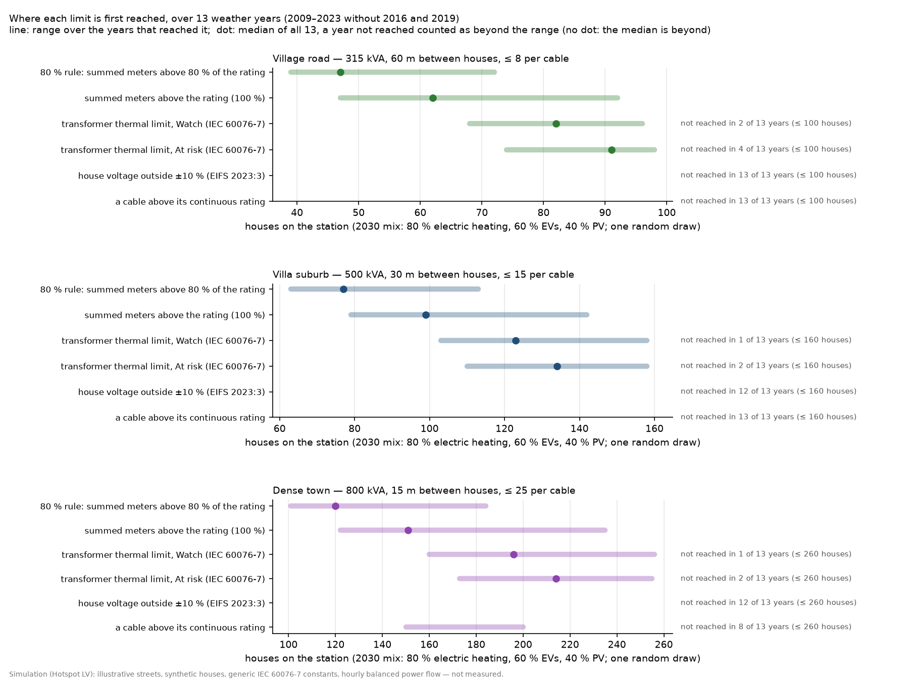
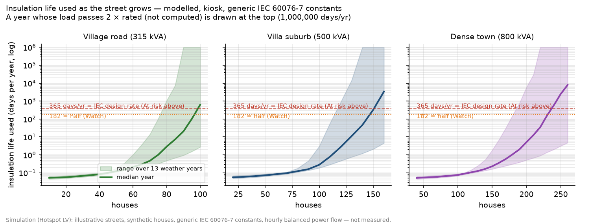
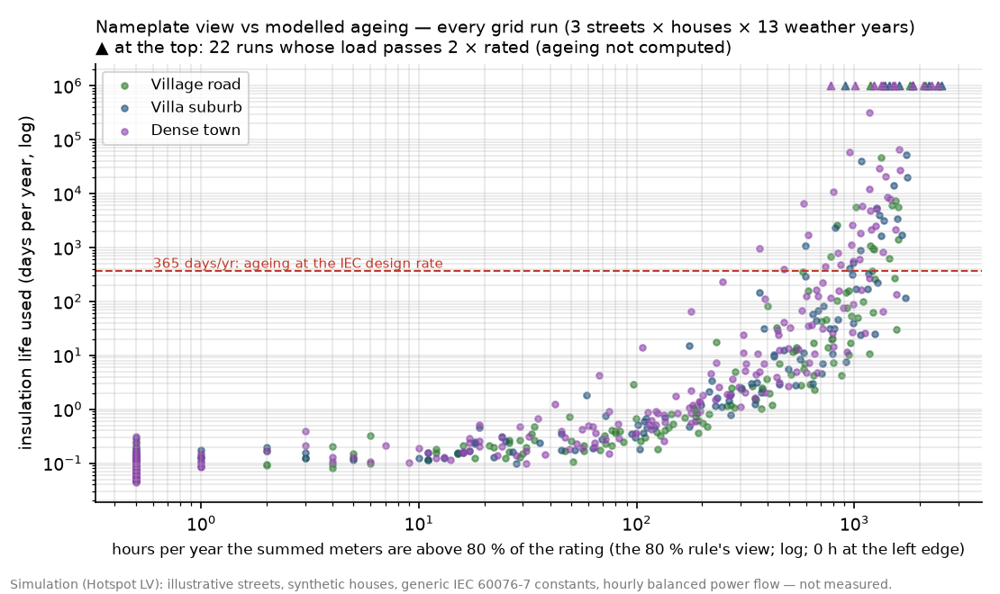
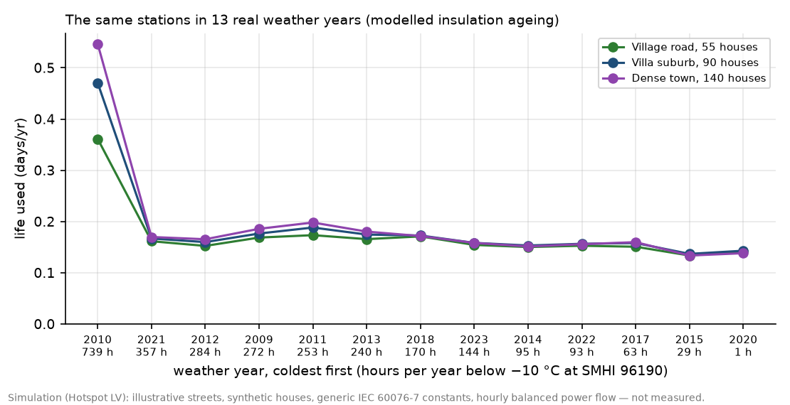
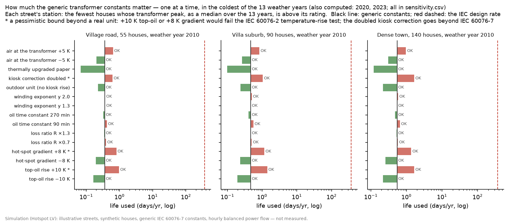
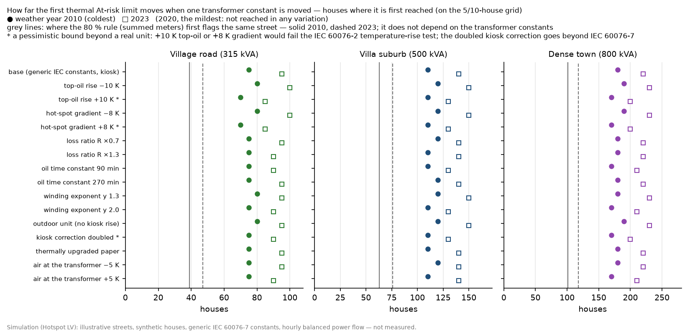

# When does a Swedish street transformer reach its IEC 60076-7 limits? A simulation study

**A thermal ageing & dynamic loading study of secondary-substation (nätstation) transformers under electrification.
Simulation only.**

> **Read this first.** Everything below is a simulation.
> - The streets are illustrative, the houses are modelled, and the transformer uses the generic constants of
>   IEC 60076-7.
> - No result has been checked against a measured station.
> - The study shows patterns and ranges. It does not describe the state of any real network, and it is not advice
>   to load any real transformer harder.
>
> The limits are listed in [section 7](#7-limitations-ranked).

---

## 1. In short

Three illustrative Swedish streets grow from a few houses to many, in a deliberately high-electrification mix
labelled 2030: 80 % of the houses heat with electricity, 60 % charge an EV at home and 40 % have rooftop PV.
- **Weather:** each house count is judged in **13 real weather years** (2009–2023 without 2016 and 2019, SMHI
  hourly temperature).
- **Models:** an hourly power flow and the IEC 60076-7 thermal model.
- **Runs:** 741 simulated years on a grid of house counts, plus 552 runs that pin each first limit to the exact
  house.
- **Spread:** the houses were drawn once, so the ranges below come from the weather years only.

1. **On these streets, the transformer reaches its IEC 60076-7 normal cyclic limit at 1.56–1.85 times the houses at
   which an 80 % planning rule first flags it (median 1.65).**
   - The long-time emergency limit comes at 1.68–2.00 times (median 1.81).
   - The rule is applied as documented, to the summed hourly meter values.
   - **This gap is an upper bound on usable headroom, not advice to load real transformers harder.** The rule's
     margin is there for reactive power, phase imbalance and peaks inside the hour. This study models only an
     assumed power factor (section 6).
2. **Most of that gap is set by the standard itself.**
   - The summed meters reach 80 % when the transformer carries 0.87–0.91 × rated, because reactive power and losses
     add about 10 %.
   - IEC 60076-7 allows 1.5 × rated current in normal cyclic loading.
   - In Swedish winter air, the modelled kiosk transformer's hot-spot reaches 120 °C at about that current: the first
     Watch comes at 1.40–1.53 × rated.
   - So the cold air does not stretch the limit beyond the standard's current limits; it lets the transformer reach
     them.
   - The peak per house barely changes above 40 houses, so the ratio of houses follows the ratio of loads.
3. **The first limit to bind is the hot-spot in a few cold late-evening and night hours; yearly ageing follows close
   behind.**
   - Every time the long-time emergency limit was first passed, the hot-spot had gone above 140 °C on a winter peak.
   - At that point the year's insulation ageing was still below the design rate: 19–167 days per year, against 365.
   - In every case where the range reached far enough (25 of 31), ageing passed the design rate 6–26 houses later,
     because the same hours drive it.
4. **Where the 80 % rule first flags, the modelled transformer is thermally far from its limits:** 0.08–0.34 days of
   insulation life used per year, and a hot-spot of at most 61 °C.
5. **On these streets, which grow by adding cables, the street itself rarely limits before the transformer.**
   - This follows largely from the assumed design: a 240 mm² main cable everywhere, and at most 8, 15 or 25 houses
     per cable.
   - A house voltage left the ±10 % band only in the coldest year, at the top of two ranges, when the transformer
     carried 2.3–2.4 × rated.
   - In the dense town, the fullest cable reached its continuous rating in 5 of 13 years, before the transformer's
     Watch in 4 of them. That result turns on the 25-houses-per-cable assumption.
6. **The weather year matters.**
   - The coldest year (2010) brought the At-risk limit 18–19 % fewer houses earlier than the 13-year median.
   - At the same station it used 2.3–3.3 times the insulation life of the median year.
   - The At-risk limit was not reached within the studied range in the two years with the fewest hours below −10 °C
     (2015, 2020), nor on the village road in 2014 and 2018.
7. **The generic transformer constants move the limit only a little.**
   - One constant was moved at a time over a plausible range. Three of the pessimistic changes go beyond what a unit
     passing its temperature-rise test can have.
   - The first At-risk point shifted by −11 % to +9 %.
   - With the most pessimistic single change, the At-risk limit still came at 1.68 or more times the houses of the
     80 % rule (in 2010 and 2023).
   - The insulation ageing is far more sensitive (up to 3 times), but it stays small at those points.
8. **This is consistent with earlier work, not a new discovery.**
   - Nazir & Bollen (Energiforsk 2024:2009) needed 1.56 × load plus 10.5 K of air for a 140 °C hot-spot on a
     measured northern-Swedish station. Here, 140 °C is reached at 1.53–1.75 × rated on cold evenings.
   - ENWL (2016) found the short-term peak risk matters more than the ageing.
   - This study adds three street types, 13 weather years, the documented rule next to the IEC limits, and a
     one-at-a-time sensitivity.

---

## 2. The question

**How DSOs plan.** Swedish distribution system operators (DSOs) plan secondary substations with nameplate rules.
Karlstads Elnät documented one of them (Energiforsk 2018:552):
- sum the customers' hourly meter values per station;
- compare the peak with **80 % of the transformer's rating**.

The report gives three reasons for the 20 % margin, and none of them is thermal. Hourly meter values hold:
- no reactive power;
- no imbalance between the phases;
- no peaks inside the hour.

**What changes.** Electrification raises winter peaks: heat pumps with electric back-up on cold days, and EVs
charging in the evening.

**The thermal limits.** A transformer's nameplate rating is not its thermal limit. IEC 60076-7, the loading guide for
oil-immersed transformers, allows loading beyond nameplate as long as temperatures and currents stay within set
limits. For distribution transformers (IEC 60076-7:2005, Table 4):

| Loading type | Current | Winding hot-spot | Top-oil |
|---|---|---|---|
| Normal cyclic loading | 1.5 × rated | 120 °C | 105 °C |
| Long-time emergency loading | 1.8 × rated | 140 °C | 115 °C |

- **Emergency loading:** the long-time emergency limits are meant for prolonged outages, not for planned everyday
  peaks. A study for planning should lead with the normal cyclic limits.
- **Other station equipment:** IEC 60076-7 (7.2.2) warns that above 1.5 × rated, other parts can limit first:
  bushings, cable ends, leads and the oil expansion.
- **Edition:** the 2018 edition renumbers these tables. Its values were not checked here.

**What this study asks.** On a Swedish street growing towards a high-electrification future:
1. How far apart are "the 80 % rule flags the station" and "the transformer reaches its IEC limits"?
2. What sets that distance?
3. Which limit comes first: the transformer, the house voltage or a cable?
4. How sure can we be, given generic transformer constants and weather that changes from year to year?

---

## 3. What is already known, and what this study adds

| Earlier work | What it found | How this study relates |
|---|---|---|
| Nazir & Bollen, LTU, Energiforsk RAPPORT 2024:2009 | IEC 60076-7 on a measured distribution transformer in northern Sweden, with the 10-minute load scaled to a 1.0 pu peak. Total ageing was about 0.35 days over 1.5 years, "försumbart" (negligible), because the highest loads come with low air temperature. To reach a 140 °C hot-spot, the load had to be raised 1.56 times **and** the air by 10.5 K. | Consistent. Here, 140 °C is reached on cold evenings at 1.53–1.75 × rated. This study adds three street types, 13 weather years, a one-at-a-time sensitivity and a comparison with voltage and cable limits. |
| Hilshey et al., IEEE Trans. Smart Grid 4(2), 2013 | In cool climates, moderate overloading from EV charging may not substantially shorten transformer life; warm climates age it more. | Consistent. The cold-climate result must not be carried to warm markets. |
| Electricity North West (ENWL) and University of Manchester, *Distribution Asset Thermal Modelling*, NIA ENWL002 closedown report and appendix 1 (Gao), 2016 | EV charging gives moderate ageing; the larger risk is short-term, at peak load (around 1.5 pu). Generic IEC constants missed measured hot-spots by up to 8.15 K. | Consistent. Here too the peak-temperature limits bind before cumulative ageing. The sensitivity covers ±8 K and more. |
| Energiforsk 2023:966 (Chalmers, Profu; dated Dec 2024) | National Swedish model: in towns, EV-charging problems come mainly from transformer overload. Voltage drop is mainly rural, though few rural LV grids have problems at all. | Consistent for the villa suburb and dense town. The "village road" here is short, not a long rural line, so it does not test the rural voltage finding. |
| Energiforsk 2026:1197 | Long periods of hard cold often dimension local grids. | Consistent: the coldest year dominates the results. |
| Phase to Phase, Vision Network Analysis (commercial; IEC 60076-7 ageing since v0.98, June 2025); Alliander transformer-thermal-model (open library, MPL-2.0) | IEC 60076-7 thermal and ageing calculations are available in a commercial load-flow tool and as an open library. | Hotspot LV is not the first tool with IEC ageing. Its own contribution is a free, open, Swedish-rules package with measured hourly weather. |

**What this study adds:**
- the comparison across three street types and 13 measured weather years;
- the planning rule applied the way it is documented (summed meters), next to the transformer's IEC limits;
- the first limit among transformer, house voltage (EIFS 2023:3) and cables;
- a one-at-a-time sensitivity to the generic constants;
- code and data that reproduce every number.

---

## 4. Method

### 4.1 The model chain

```
 SMHI hourly air temperature              PVGIS hourly PV output
            │                                       │
            ▼                                       ▼
 houses (2030 mix) ──► hourly kW per house: household + heating + EV − PV, capped at the 20 A main fuse
            │                                         │
            │                                         └──► summed meters (active power drawn) ──► the 80 % rule
            ▼
 street: transformer + N main cables + a service cable per house ──► hourly power flow (pandapower)
            │                                                          │
            ▼                                                          ▼
 transformer loading K = kVA / rated kVA                    house voltages, cable currents
            │
            ▼
 IEC 60076-7 thermal model (kiosk) ──► top-oil, winding hot-spot, insulation ageing
            │
            ▼
 verdict per year: OK / Watch / At risk, with the rule that caused it
```

All of this is the engine of the Hotspot LV app (`src/hotspotlv`). The study scripts in `study/` only choose the
cases and collect the results.

### 4.2 The three streets

The street types are **illustrative assumptions, not measured networks.**
- **How a street grows:** the way a planner would build it. Each main cable feeds at most N houses, so more houses
  means **more cables from the same transformer**, not longer cables.
- **The transformer is not resized**, because the question is where *this* transformer's limits are.

| Street | Transformer | Main cable between house connections | Houses per cable (max) | Longest cable | Houses studied |
|---|---|---|---|---|---|
| Village road | 315 kVA, uk 4 % | 60 m | 8 | 480 m | 10–100, step 5 |
| Villa suburb | 500 kVA, uk 6 % | 30 m | 15 | 450 m | 20–160, step 10 |
| Dense town | 800 kVA, uk 6 % | 15 m | 25 | 375 m | 40–260, step 10 |

**Common to all streets:**
- Network:
  - 10/0.4 kV Dyn11, with the MV side held at 1.00 pu and no tap.
  - Main cables AXQJ 4×240 Al; service cables AXQJ 4×50 Al, 15 m.
  - A 20 A three-phase main fuse per house.
- Cables:
  - Continuous ratings from the Prysmian datasheet (in ground, 20 °C soil).
  - No derating for grouping, even though 10–13 cables leave one kiosk.
  - No cyclic or cold-soil credit.
  - Cable resistance at 20 °C (at full current it is up to about 28 % higher).
- Power flow: balanced (one phase represents three) and hourly.

**Impedance and voltage.** A Swedish DSO's specification (Ellevio, 2022) uses uk 4 % up to 500 kVA and 4.5 % at
800 kVA, and a 420 V no-load secondary voltage.
- The 6 % used here gives more voltage drop than that, which is conservative for undervoltage.
- The 400 V secondary and 1.00 pu sending voltage give less voltage rise in PV hours, which is optimistic for
  overvoltage.

### 4.3 The houses: a high-electrification mix, labelled 2030

| | Share of houses |
|---|---|
| Ground-source heat pump | 30 % |
| Air/water heat pump | 30 % |
| Direct electric heating | 20 % |
| No electric heating (district heating, wood) | 20 % |
| Home-charged EV (unmanaged: charging starts on arrival, around 17:30; 11 / 7.4 / 3.7 kW chargers) | 60 % |
| Rooftop PV | 40 % |

This is a deliberately high-electrification scenario, not a forecast. For scale: at the end of 2025, 16 % of Swedish
cars in traffic were chargeable, and 61 % of the new cars that year (Trafikanalys 2026).

- **Household electricity:** built from measured hourly 2021 profiles of 63 Norwegian detached houses without heat
  pumps (Hofmann, Bjarghov & Nessa 2023, Zenodo 8423312, CC BY 4.0).
  - Most of these houses heat with direct electricity, so only their summer days (June–August) are used, as daily
    shapes drawn at random.
  - A monthly factor from the five houses without electric space heating (January ≈ 2 × July) restores the seasons.
  - Each house is scaled to a Swedish annual household-electricity level (mean 5 650 kWh).
  - The shapes still include the houses' water heaters.
- **Heating:**
  - Each house has its own heat loss (±20 %) and pump size.
  - The heat pump's output and efficiency fall in the cold, and an electric back-up heater covers the rest. That
    back-up is why Swedish winter peaks bite.
  - The houses have no thermal mass in the model, so demand follows each hour's temperature. This sharpens the peaks.
- **Same dice every year:**
  - The houses, cars and panels are drawn once (seed 0). Only the weather changes between the 13 years.
  - The spread between different draws was not studied.

### 4.4 The weather: 13 years

**Temperature.**
- Source: hourly air temperature from **SMHI station 96190, Eskilstuna A**, about 26 km from Västerås (corrected
  archive, CC BY 4.0).
- Each value is SMHI's reading at the start of the hour, used for that hour.
- Gaps of up to 6 h are interpolated.

**PV.**
- Source: hourly PV output from **PVGIS 5.3 (SARAH3)** for Västerås: 1 kWp, 30° tilt, facing south, 14 % system
  losses.
- PVGIS gives its value at minute 11 of each hour, and it is used for that hour.

**Calendar.** Each weather year is a Swedish calendar year (1 Jan 00:00 – 31 Dec 23:00 local time), so it holds the
end of one winter and the start of the next. File details and attribution are in
[study/data/README.md](study/data/README.md).

- **Years:** 2009–2015, 2017, 2018 and 2020–2023.
- **Left out:** 2016 and 2019. SMHI's archive has gaps longer than 6 h in both, which the program does not fill:
  four of 11 h in 2016, and one of 7 h and one of 11 h in 2019. PVGIS SARAH3 ends in 2023.
- **Data quality:** in 2009 and January–July 2010, two of every three hours carry SMHI's quality code Y (only
  roughly checked), including 2010's coldest hour. They agree with the fully checked 3-hourly values around them as
  closely as fully checked years do.

| Year | Hours below −10 °C | Coldest hour | Mean |
|---|---|---|---|
| 2009 | 272 | −23.9 °C | 6.6 °C |
| **2010 (coldest)** | **739** | **−28.7 °C** | **4.8 °C** |
| 2011 | 253 | −25.8 °C | 7.6 °C |
| 2012 | 284 | −22.2 °C | 6.4 °C |
| 2013 | 240 | −22.7 °C | 6.8 °C |
| 2014 | 95 | −17.3 °C | 8.0 °C |
| 2015 | 29 | −14.4 °C | 7.7 °C |
| 2017 | 63 | −24.8 °C | 7.3 °C |
| 2018 | 170 | −16.3 °C | 7.9 °C |
| **2020 (mildest)** | **1** | **−10.2 °C** | **9.0 °C** |
| 2021 | 357 | −21.2 °C | 7.1 °C |
| 2022 | 93 | −21.1 °C | 8.0 °C |
| 2023 | 144 | −20.5 °C | 7.2 °C |

"Coldest" and "mildest" refer to the hours below −10 °C.

### 4.5 The transformer

- **Losses:** Ecodesign Tier 2, from Commission Regulation (EU) No 548/2014, as amended by (EU) 2019/1783, Annex I,
  Table I.1 (liquid-immersed medium power transformers).
  - 315 kVA: 2 800 W load loss, 324 W no-load loss.
  - 500 kVA: 3 900 W and 459 W.
  - 800 kVA: 6 000 W and 585 W.
  - The loss ratio R comes from these: 8.6, 8.5 and 10.3.
- **Thermal constants:** the generic IEC 60076-7:2005 values for a distribution ONAN transformer (Table 5, Annex E).
  - Top-oil rise at rated load: 55 K. Hot-spot-to-top-oil gradient: 23 K. Their sum, 78 K, equals the hot-spot-rise
    limit of IEC 60076-2.
  - Exponents x = 0.8, y = 1.6.
  - Time constants: τo = 180 min, τw = 4 min. Factors k11 = 1, k21 = 1, k22 = 2.
- **Kiosk:** a Swedish nätstation is normally a prefabricated kiosk. Following IEC 60076-7:2005 (8.3.2, Table 6,
  eq. 11), half of the kiosk's extra air rise is added to the top-oil rise.
  - At rated load this is +5.7 K (315 kVA), +7.5 K (500 kVA) and +10 K (800 kVA). Table 6 stops at 750 kVA, whose
    value is used for 800 kVA.
  - As in the standard's equations, the correction grows with the losses, to about twice that at 1.6 × rated.
- **Insulation:** non-upgraded kraft paper. The ageing rate is 1 at 98 °C and doubles with every 6 K (halves below).
  One day of life per day (365 days per year) is the design rate.

### 4.6 The two views and the verdict

**What the planner sees.** The houses' hourly meter values are summed: the active power each house draws, without
reactive power or losses. The sum is compared with the transformer's kVA rating, as the documented 80 % rule does.
At the same hour, the transformer's modelled loading is 1.08–1.16 times this sum (power factor 0.95 assumed,
plus losses). So the rule here flags later than a rule applied to the transformer's own kVA would.

**What the transformer sees.** Each simulated year gets one verdict from the modelled loading, and any single rule
is enough:

| Verdict | Rule | Source |
|---|---|---|
| **At risk** | insulation ageing faster than design (more than 365 days of life per year) | IEC 60076-7 |
| **At risk** | hot-spot above 140 °C, top-oil above 115 °C, or load above 1.8 × rated | IEC 60076-7:2005 Table 4, long-time emergency |
| **At risk** | a house voltage outside 0.90–1.10 pu in any hour | EIFS 2023:3, 6 kap. 3 § (the regulation uses 10-minute values; this is hourly and balanced) |
| **Watch** | ageing above 182 days of life per year (half the design rate) | a margin chosen for model optimism |
| **Watch** | hot-spot above 120 °C, top-oil above 105 °C, or load above 1.5 × rated | IEC 60076-7:2005 Table 4, normal cyclic |
| **Watch** | a house voltage outside 0.92–1.05 pu | a planning margin |
| **Watch** | a cable above its continuous rating | the cable datasheet |

Above 2.0 × rated (the IEC short-time emergency limit), the thermal figures are not computed and the verdict says so.
In the tables below, the transformer's **thermal limit** means its thermal and current rules (the first, second,
fourth and fifth rows); voltage and cables are counted separately.

### 4.7 "First reached", exactly

"First reached" is the smallest house count at which a rule is met in a given weather year.
- **The grid.** The study first runs a grid of house counts (steps of 5 or 10).
- **The exact step.** Then, for the two meter rules and the transformer's thermal Watch and At risk, every house
  count inside the step just below the first grid count is run too. Those first counts are exact to one house.
- **Voltage and cables** are read on the grid only. The cable loading comes and goes as cables fill up, because the
  fullest cable carries up to N houses at almost any street size. A first count between grid points would only
  reflect that alignment.

### 4.8 Fast mode

The full-year power flow is 8 760 hours, and the study uses the app's fast mode:
- A proxy fitted to a sample of exact power flows gives every hour.
- The hours near any limit (above 90 % loading, voltage or cable bands) are re-run exactly.
- When the proxy does not fit well enough, the whole year is run exactly.

Of the 741 grid runs, 727 ran in fast mode and 14 in full. Of the 552 refining runs, 549 ran fast and 3 in full.

The meter rule needs no power flow, so it is exact.

---

## 5. Results

### 5.1 Where each limit is first reached



The houses at which each limit is first reached:

| Street | 80 % rule (summed meters) | Summed meters above the rating | Thermal: Watch | Thermal: At risk | Voltage ±10 % | Cable rating (grid) |
|---|---|---|---|---|---|---|
| Village road, 315 kVA | 39 / 47 / 72 (13) | 47 / 62 / 92 (13) | 68 / 82 / 96 (11) | 74 / 91 / 98 (9) | not reached (≤ 100) | not reached (≤ 100) |
| Villa suburb, 500 kVA | 63 / 77 / 113 (13) | 79 / 99 / 142 (13) | 103 / 123 / 158 (12) | 110 / 134 / 158 (11) | 160 (1), at 2.4 × rated | not reached (≤ 160) |
| Dense town, 800 kVA | 101 / 120 / 184 (13) | 122 / 151 / 235 (13) | 160 / 196 / 256 (12) | 173 / 214 / 255 (11) | 250 (1), at 2.3 × rated | 150 / – / 200 (5) |

How to read a cell:
- **Three numbers:** the fewest houses in any year / the median over all 13 years / the most houses in a year that
  reached the limit.
- **The median** counts a year that did not reach the limit as beyond the range. "–" means the median itself is
  beyond the range.
- **In brackets:** the number of weather years in which the limit was reached within the studied range.
- **Precision:** the meter and thermal columns are exact to one house. Voltage and cables are on the 5/10-house grid.

**The ratio of the thermal limit to the 80 % rule**, per weather year, with both counts exact to one house:

| Street | Thermal Watch ÷ 80 % rule | Thermal At risk ÷ 80 % rule |
|---|---|---|
| Village road | 1.69–1.85, median 1.74 (11 years; in the other 2, above 1.39 and 1.59) | 1.82–2.00, median 1.94 (9 years; in the other 4, above 1.39–1.92) |
| Villa suburb | 1.56–1.67, median 1.61 (12 years; in the other, above 1.42) | 1.68–1.86, median 1.75 (11 years; in the other 2, above 1.42 and 1.63) |
| Dense town | 1.58–1.69, median 1.64 (12 years; in the other, above 1.41) | 1.71–1.87, median 1.80 (11 years; in the other 2, above 1.41 and 1.65) |
| All | 1.56–1.85, median 1.65 (35 street-years) | 1.68–2.00, median 1.81 (31 street-years) |

"Above x" is a lower bound: in that year the limit was not reached even at the largest house count studied.

**Why the ratio is about 1.6–2.** It follows mostly from the IEC limits themselves, not from a large thermal margin:
- The rule flags when the summed meters pass 0.8 × rating. The transformer then carries 0.87–0.91 × rated, because
  it sees 1.08–1.16 times the meter sum (power factor 0.95 assumed, plus losses).
- The transformer's first Watch comes at 1.40–1.53 × rated, close to the IEC normal cyclic current limit of 1.5.
- The peak per house is 5.5–6.1 kVA at every house count from 40 up, so the ratio of houses follows the ratio of
  loads.
- In steady state at −25 °C, the modelled kiosk unit reaches 120 °C at 1.39–1.44 × rated and 140 °C at
  1.51–1.56 × rated.
- The winter evening peaks reach 1.53–1.75 × rated before passing 140 °C only because the oil (τo = 3 h) lags behind
  a peak lasting a few hours.

**Which limit comes first**, among the transformer's thermal Watch, the house voltage and the cable rating:

| Street | Transformer | A cable | Nothing within the range |
|---|---|---|---|
| Village road | 11 of 13 years | – | 2 |
| Villa suburb | 12 of 13 | – | 1 |
| Dense town | 8 of 13 | 4 | 1 |

**The cable comes and goes as cables are added.** In the dense town, the fullest cable carries 25 houses whenever
the count is a multiple of 25. At those counts it runs at 98–113 % of its continuous rating in the coldest year,
whatever the street size (61–113 % over all years). It was first flagged at 150 or 200 houses, at 100–109 %. So "a cable first in 4 of 13 years" rests on the
25-houses-per-cable assumption and on margins of 0–9 %.

### 5.2 What stops the transformer: short peaks first, ageing right behind



How the transformer stands at each first-reached point (exact house counts):

| Point | Summed meters | Transformer loading | Max hot-spot | Insulation life used | What triggered it |
|---|---|---|---|---|---|
| 80 % rule first flags | 80–83 % | 87–91 % | 41–61 °C | 0.08–0.34 days/yr | the rule |
| Summed meters first above the rating | 100–103 % | 109–113 % | 64–87 °C | 0.13–1.6 days/yr | the rule |
| Thermal Watch first reached | 130–136 % | 140–153 % | 112–125 °C | 2.0–22 days/yr | hot-spot above 120 °C in 29 of 35 cases; in the other 6, load above 1.5 × rated |
| Thermal At risk first reached | 137–147 % | 153–175 % | 140–145 °C | 19–167 days/yr | hot-spot above 140 °C in all 31 cases |

**The deciding peaks.**
- They are a few cold late-evening and night hours. In the coldest year, at the village road's first At-risk point
  (74 houses), the hot-spot was above 140 °C for 2 hours: 23:00 and midnight on 5–6 January, with the air at −29 and
  −27 °C. It was above 120 °C for 35 hours that year, all between 18:00 and 11:00.
- At the first At-risk point the year's ageing is still below the design rate, but it rises steeply. In every case
  where the range reached far enough (25 of 31), it passed 365 days per year 6–26 houses later (7–19 % more houses).
- This agrees with the ENWL finding that the short-term risk at peak load matters more than cumulative ageing.

**Why the temperature limits matter in their own right.** IEC 60076-7:2005 (5.3, 7.2.1) links hot-spot temperatures
above 140 °C to gas bubbles forming in the insulation, where the electrical stress is high. That threshold assumes
dry paper (about 2 % moisture) and falls in wetter, older units.



- **The rule's own view:** the hours per year the summed meters spend above 80 % rise steadily as the street grows.
- **The thermal model's view:** the modelled ageing stays tiny until the peaks approach the IEC limits, then rises
  steeply.
- **The consequence:** two stations with the same "hours above 80 %" can be very far apart thermally.

### 5.3 Weather year to weather year



**Ageing at a fixed station.** Each street's reference station is the fewest houses whose transformer peak, as a
median over the 13 years, is above its rating: 55, 90 and 140 houses. There, insulation life used in the coldest
year (2010) is 2.3–3.3 times that of the median year.

**The first At-risk point.** It comes 18–19 % fewer houses earlier in 2010 than the median over all 13 years:

| Street | 2010 | Median of 13 years | Not reached (≤ studied range) |
|---|---|---|---|
| Village road | 74 houses | 91 houses | 2014, 2015, 2018, 2020 |
| Villa suburb | 110 houses | 134 houses | 2015, 2020 |
| Dense town | 173 houses | 214 houses | 2015, 2020 |

A study with a single typical year would miss the year that decides.

### 5.4 How much the generic transformer constants matter



**At each street's reference station.** One constant was moved at a time, in 2010, 2020 and 2023 (144 cases):
- **Every verdict stays OK.**
- Life used ranges over 0.01–1.66 days per year. The highest hot-spot is 104 °C.
- **Largest effects (2010, dense town; generic constants: 0.55 days/yr):**
  - top-oil rise +10 K: 1.66;
  - kiosk correction doubled: 1.66;
  - hot-spot gradient +8 K: 1.37;
  - air at the transformer +5 K: 0.97;
  - outdoor unit, with no kiosk: 0.22.
- **Thermally upgraded paper** cuts the ageing 4.6–5.3 times in 2010, and about 10–11 times in the milder 2020 and
  2023. The two ageing laws diverge at low temperatures.

**Three variations, marked \*, are pessimistic bounds beyond a real unit:**
- A top-oil rise of 65 K (+10 K) would fail the IEC 60076-2 temperature-rise test (60 K).
- So would a hot-spot rise of 86 K (+8 K gradient, against a limit of 78 K).
- The doubled kiosk correction goes beyond either reading of IEC 60076-7 Table 6.

The ±8 K is applied to the rated gradient, so it grows to about ±17 K at 1.6 × rated, more than the 8 K hot-spot
error ENWL measured. The "air at the transformer" variation moves only the temperature around the transformer, not
the heating demand of the houses.

At the point where a planner first sees "overloaded on paper", no single plausible change of a constant brings the
transformer near a thermal limit.

**How far the limit itself moves.**
- The same 16 variations were run for every house count on the grid of every street, in 2010, 2020 and 2023: 171
  loading years, each judged 16 times.
- The loading of a house count does not depend on the transformer constants, so the 80 % rule's first flag stays
  where it is. Only the thermal verdict moves.



| Street | Weather year | 80 % rule first flags (exact) | First At risk, generic constants (grid) | First At risk, range over the 15 variations (grid) |
|---|---|---|---|---|
| Village road | 2010 | 39 houses | 75 | 70–80 |
| Village road | 2023 | 47 | 95 | 85–100 |
| Villa suburb | 2010 | 63 | 110 | 110–120 |
| Villa suburb | 2023 | 76 | 140 | 130–150 |
| Dense town | 2010 | 101 | 180 | 170–190 |
| Dense town | 2023 | 118 | 220 | 200–230 |

- **The first At-risk point moves by −11 % to +9 %**, at most two steps of the grid. In every row, the two
  pessimistic bounds (top-oil rise +10 K\*, hot-spot gradient +8 K\*) are among the changes that bring it earliest.
- **With the most pessimistic single change, the At-risk limit still comes at 1.68 or more times** the houses at which
  the 80 % rule flags (1.68–1.81 across the six rows). Over all variations the range is 1.68–2.13.
- **Watch moves less.** The first Watch comes at 1.49 or more times, partly because the 1.5 × rated current limit
  does not depend on the constants.
- **In 2020**, the mildest year, no variation reached Watch or At risk within the studied range.
- **Why the limit moves so little while the ageing moves up to 3 times.** Near the limit, the hot-spot climbs steeply
  with load: a few kelvin of error in a constant is worth only a few per cent of load. The ageing rate, in contrast,
  doubles with every 6 K.
- **Not computed:** several constants wrong in the same direction at once. Such a combination would move the limit
  further than any single change shown here.

---

## 6. What it means

**For a planner.** On these modelled streets, the step from "the 80 % rule flags the station" to "the transformer
reaches its IEC normal cyclic limit" is 1.56–1.85 times the houses (median 1.65). That gap is an upper bound on usable headroom. A DSO could
consider using part of it only after, at least, these steps. This study checks none of them on a real station.
1. Measure what the rule's margin covers: reactive power, phase imbalance and peaks inside the hour. Swedish meters
   must be able to record these per phase, with energy every quarter-hour, from the 2025 metering year
   (förordning 1999:716, §§ 25–26 and 30; from 1 Jan 2027 elsystemförordningen 2026:1522, 10 kap. 31, 32 and 36 §§).
2. Check the unit's own thermal data, age, condition and kiosk.
3. Check everything else in the station that carries the current. This means MV and LV fuses or breakers, the LV
   switchgear, bushings and cable terminations (IEC 60076-7:2005, 7.2.2).
4. Check voltage and cables on the real street.

The decisive case is a cold year like 2010, not a typical one.

**For transformer engineering.**
- **The binding stress:** on these modelled streets it is a few cold late-evening and night hours at about
  1.4–1.8 × rated current, not cumulative ageing, and the ageing follows close behind.
- **Where measured data would change a decision:** in those hours. That means measured temperatures (top-oil,
  hot-spot) and the manufacturer's heat-run data.
- **What moves the answer most:** the top-oil rise, the hot-spot gradient and the kiosk. Upgraded paper changes the
  ageing several times over.
- **Scope:** the result is for a cold climate and must not be carried to warm markets (Hilshey 2013).

---

## 7. Limitations, ranked

1. **No validation against a measured station.** Nothing here shows that the summed synthetic houses match a real
   transformer's current, or that the generic constants match a real unit. With generic constants, ENWL found
   measured hot-spot errors of up to 8 K.

   The next step that would most strengthen the study is one real station: summed meters against a station
   measurement, and a top-oil log through a cold week.
2. **Hourly and balanced, against a minute-scale hot-spot and a 10-minute, per-phase regulation.**
   - **What binds:** the winding hot-spot, which follows the load within minutes (τw = 4 min).
   - **What the model hides:** hourly means hide peaks inside the hour, such as an EV starting or a back-up heater
     switching on. A balanced model hides the most-loaded phase.
   - **Effect:** both would bring the thermal and voltage limits to fewer houses than shown here, so the ratios in
     section 1 are optimistic by an amount not estimated here.
   - **Harmonics:** harmonics from inverter heat pumps and EV chargers add winding losses (IEEE C57.110), which acts
     in the same direction.
3. **Only the transformer's windings and oil are judged.**
   - The unit is assumed new and dry. Moisture and oxygen in an older unit speed up ageing several times and lower
     the temperature at which gas bubbles can form.
   - Fuses, breakers, LV switchgear, bushings and cable terminations are not modelled, and above 1.5 × rated they can
     limit first.
4. **Synthetic houses, one location, one mix and one draw.**
   - One household data set (Norwegian houses), one heating model with no thermal mass, one high-electrification
     mix, and one random draw (seed 0).
   - The sharp peaks of the house model bring both the rule and the thermal limits to fewer houses. Its effect on
     the ratio between them was not tested.
5. **Illustrative streets.**
   - The houses-per-cable and spacing values are assumptions, and every street uses the same 240 mm² main cable.
   - The cable result depends on them directly (section 5.1).
   - Long rural lines (1–2 km to scattered farms, often with thinner cables) were not modelled. There, voltage would
     likely limit first, as the national model finds for rural grids, which it also finds rarely have problems at
     all (Energiforsk 2023:966).
   - The voltage results also depend on the impedance, tap and sending-voltage choices (section 4.2).
6. **Generic IEC constants, one at a time.**
   - Section 5.4 shows how much each matters on its own.
   - Several constants wrong in the same direction were not tested together.
   - The pessimistic side of three variations goes beyond what a unit passing its temperature-rise test can have.
7. **No cold-oil (viscosity) correction.**
   - In very cold, lightly loaded oil the model is optimistic.
   - At the deciding peaks the top-oil is already 90–98 °C, so the effect there is probably small. It is
     not quantified.
8. **One SMHI station for the air around the transformer.**
   - A real kiosk site can be warmer or colder (the ±5 K case in section 5.4).
   - Part of 2009–2010 is only roughly checked by SMHI (section 4.4).

---

## 8. Reproduce

Python 3.11 or newer. From the repository root:

```bash
pip install -e ".[dev]"
python study/make_weather_years.py   # 13 weather files in study/data/weather (already committed)
python study/run_study.py            # 741 runs → study/results/runs.csv (resumable; about 45 min on 12 cores)
python study/run_study.py --meters   # summed meter values → study/results/meter_sums.csv (about 2 min)
python study/refine.py               # exact first counts → study/results/*_fine.csv (about 1 h)
python study/sensitivity.py          # → study/results/sensitivity.csv and sensitivity_limits.csv (about 20 min)
python study/figures.py              # → docs/figures/*.png and study/results/summary_*.csv
pytest tests/test_study_runner.py    # the study's own checks
```

The weather files are committed, so `make_weather_years.py` is needed only to rebuild them from SMHI and PVGIS.

---

## 9. Sources

- IEC 60076-7:2005, *Power transformers – Part 7: Loading guide for oil-immersed power transformers*:
  - Table 4 (limits), Table 5 (thermal characteristics), Table 6 and eq. 11 (kiosk), eqs. 2–4 (ageing);
  - clauses 5.3 and 7.2.1 (gas bubbles), 7.2.2 (ancillary equipment).
  - The 2018 edition renumbers these; its values were not checked here.
- IEC 60076-2:2011, *Temperature rise for liquid-immersed transformers* (top-oil 60 K, hot-spot 78 K for ON
  cooling).
- Energimarknadsinspektionen, EIFS 2023:3, 6 kap. 3 § (voltage within 90–110 % in all 10-minute values).
  https://lagen.nu/eifs/2023:3
- Lindborg, Schumacher (Sustainable Innovation), *Elbilsutvecklingens påverkan på lokalnätsdimensionering av
  nätstationer*, Energiforsk 2018:552 (Dec 2018). The method is Karlstads Elnät's: the 80 % rule and its three stated
  reasons.
- Nazir, Bollen (LTU), *Stokastisk dynamisk belastningsförmåga för transformatorer*, Energiforsk RAPPORT 2024:2009
  (April 2024).
- Hilshey, Hines, Rezaei, Dowds, "Estimating the impact of electric vehicle smart charging on distribution
  transformer aging", IEEE Trans. Smart Grid 4(2), pp. 905–913, June 2013, doi:10.1109/TSG.2012.2217385.
- Electricity North West / University of Manchester, *Distribution Asset Thermal Modelling*, NIA ENWL002 closedown
  report (Sept 2016) and appendix 1 (Y. Gao).
- Energiforsk 2023:966, *Påverkan på elsystemet och elnätet av en storskalig elektrifiering av fordonsflottan*
  (Dec 2024).
- Fritz, Helbrink, Zaya, Lindén, Andersson, *Konkurrensen om efterfrågeflexibilitet – delrapport:
  simuleringsstudie olika effektavgifter*, Energiforsk 2026:1197 (June 2026).
- Förordning (1999:716) om mätning, beräkning och rapportering av överförd el, §§ 25–26, 30. It is repealed from
  1 Jan 2027 by elsystemförordningen (2026:1522), where the same requirements are in 10 kap. 31, 32 and 36 §§.
- Commission Regulation (EU) No 548/2014 (Ecodesign for power transformers), as amended by (EU) 2019/1783, Annex I,
  Table I.1.
- Ellevio, *Technical specifications oil-immersed distribution transformers*, rev 3.0, 2022 (uk and secondary
  voltage for comparison).
- SMHI open data, station 96190 Eskilstuna A, hourly air temperature. CC BY 4.0, "Source: SMHI".
- PVGIS 5.3, SARAH3. "PVGIS © European Communities, 2001–2026".
- Hofmann, Bjarghov, Nessa, *Norwegian hourly residential electricity demand data with consumer characteristics
  during the European energy crisis*, Zenodo 8423312 (2023), CC BY 4.0.
- Trafikanalys, *Fordon i län och kommuner 2025* (Statistik 2026:2, Feb 2026).
- Phase to Phase, *Thermal loading capacity of cables and transformers*, 26-006 SNI (16 Jan 2026).
- Alliander, transformer-thermal-model (MPL-2.0).
